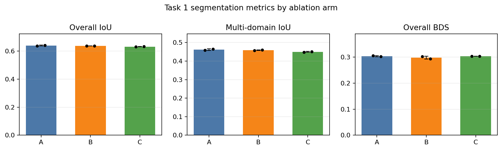
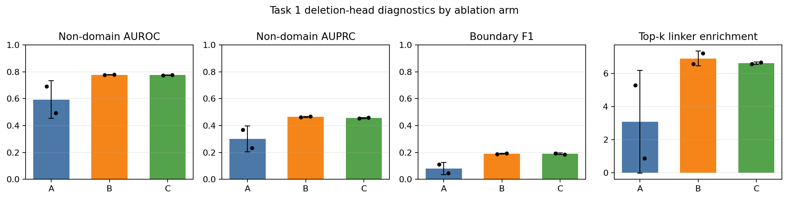

# TED Deletion-Diffusion Task 1 Ablation Report

Generated: 2026-08-05

## Executive Summary

The Task 1 ablation did **not** show a segmentation benefit from the deletion-diffusion auxiliary losses. The no-diffusion control, arm A, was the best overall and multi-domain segmentation arm by a small margin. Arm B, real deletion supervision only, learned a much stronger non-domain deletion signal, but this did not transfer into improved CATH1363 segmentation under auxiliary-only inference (`deletion_fusion_alpha=0`). Arm C, real deletion plus the current artificial insertion loss, was the weakest segmentation arm and did not materially improve deletion diagnostics beyond B.

The practical conclusion is: **do not treat the current deletion objective as a useful segmentation regularizer yet**. It is useful as a diagnostic/non-domain detector, but the model still needs a better way to couple deletion evidence to domain boundary decisions.

## Runs Analyzed

Training array job: `1466956`

Benchmark array job: `1466961`

All six checkpoints and benchmark summaries were present:

```text
artifacts/ablation_task1/ablation_A_seed0.pt
artifacts/ablation_task1/ablation_A_seed1.pt
artifacts/ablation_task1/ablation_B_seed0.pt
artifacts/ablation_task1/ablation_B_seed1.pt
artifacts/ablation_task1/ablation_C_seed0.pt
artifacts/ablation_task1/ablation_C_seed1.pt
```

All training logs reported the same CATH vocabulary sizes:

```text
[5, 41, 1105, 3412]
```

Ablation arms:

| arm | description | deletion loss | artificial insertion loss | linker dropout loss | inference alpha |
| --- | --- | ---: | ---: | ---: | ---: |
| A | no diffusion | 0.00 | 0.00 | 0.00 | 0.0 |
| B | real deletion only | 0.25 | 0.00 | 0.00 | 0.0 |
| C | real + current artificial insertion | 0.25 | 0.10 | 0.00 | 0.0 |

## Reference Context

| system                        | overall IoU | multi IoU | overall BDS |
| ----------------------------- | ----------- | --------- | ----------- |
| Gen1 grammar reference        | 0.675       | 0.485     | 0.562       |
| Chainsaw reference            | 0.880       | 0.832     | 0.789       |
| Best ablation run: A_seed1    | 0.641       | 0.466     | 0.302       |
| Best deletion signal: B_seed1 | 0.636       | 0.460     | 0.294       |

None of the ablation runs beat the Gen1 grammar reference, and all remain far below the Chainsaw benchmark target.

## Arm-Level Summary: Overall Chains

Values are mean +/- sample SD across seeds 0 and 1.

| arm                 | IoU             | correct prop    | BDS             | NDO             | domain count match | correct CATH    | non-domain AUROC | non-domain AUPRC | boundary F1     | linker enrich   | budget r        |
| ------------------- | --------------- | --------------- | --------------- | --------------- | ------------------ | --------------- | ---------------- | ---------------- | --------------- | --------------- | --------------- |
| A no diffusion      | 0.639 +/- 0.003 | 0.512 +/- 0.002 | 0.303 +/- 0.002 | 0.552 +/- 0.002 | 0.699 +/- 0.002    | 0.208 +/- 0.001 | 0.593 +/- 0.140  | 0.301 +/- 0.097  | 0.080 +/- 0.045 | 3.084 +/- 3.113 | 0.462 +/- 0.006 |
| B real deletion     | 0.636 +/- 0.001 | 0.507 +/- 0.001 | 0.298 +/- 0.006 | 0.548 +/- 0.000 | 0.698 +/- 0.001    | 0.208 +/- 0.000 | 0.778 +/- 0.002  | 0.465 +/- 0.005  | 0.191 +/- 0.003 | 6.913 +/- 0.453 | 0.460 +/- 0.005 |
| C real + artificial | 0.631 +/- 0.001 | 0.504 +/- 0.002 | 0.303 +/- 0.000 | 0.548 +/- 0.001 | 0.686 +/- 0.000    | 0.206 +/- 0.001 | 0.776 +/- 0.001  | 0.456 +/- 0.004  | 0.190 +/- 0.006 | 6.629 +/- 0.068 | 0.456 +/- 0.002 |

## Arm-Level Summary: Multi-Domain Chains

| arm                 | IoU             | correct prop    | BDS             | NDO             | domain count match | correct CATH    | non-domain AUROC | non-domain AUPRC | boundary F1     | linker enrich   | budget r        |
| ------------------- | --------------- | --------------- | --------------- | --------------- | ------------------ | --------------- | ---------------- | ---------------- | --------------- | --------------- | --------------- |
| A no diffusion      | 0.462 +/- 0.005 | 0.305 +/- 0.002 | 0.264 +/- 0.001 | 0.356 +/- 0.003 | 0.470 +/- 0.003    | 0.252 +/- 0.002 | 0.578 +/- 0.127  | 0.332 +/- 0.076  | 0.059 +/- 0.025 | 2.261 +/- 1.911 | 0.286 +/- 0.005 |
| B real deletion     | 0.459 +/- 0.002 | 0.302 +/- 0.007 | 0.265 +/- 0.005 | 0.353 +/- 0.001 | 0.468 +/- 0.002    | 0.252 +/- 0.000 | 0.711 +/- 0.004  | 0.429 +/- 0.005  | 0.181 +/- 0.004 | 4.913 +/- 0.407 | 0.290 +/- 0.002 |
| C real + artificial | 0.450 +/- 0.002 | 0.293 +/- 0.006 | 0.268 +/- 0.002 | 0.352 +/- 0.000 | 0.449 +/- 0.003    | 0.250 +/- 0.000 | 0.710 +/- 0.001  | 0.422 +/- 0.005  | 0.181 +/- 0.004 | 4.815 +/- 0.170 | 0.282 +/- 0.002 |

## Deltas Against Arm A

| comparison            | overall IoU delta | multi IoU delta | overall BDS delta | non-domain AUROC delta | non-domain AUPRC delta |
| --------------------- | ----------------- | --------------- | ----------------- | ---------------------- | ---------------------- |
| B real deletion - A   | -0.003            | -0.003          | -0.006            | +0.184                 | +0.164                 |
| C real+artificial - A | -0.008            | -0.012          | -0.001            | +0.182                 | +0.156                 |

## Per-Run Metrics

| run     | group   | IoU   | correct prop | BDS   | ndo   | domain count match | correct CATH | non-domain AUROC | non-domain AUPRC | boundary F1 | linker enrich | budget r |
| ------- | ------- | ----- | ------------ | ----- | ----- | ------------------ | ------------ | ---------------- | ---------------- | ----------- | ------------- | -------- |
| A_seed0 | overall | 0.637 | 0.511        | 0.305 | 0.551 | 0.698              | 0.209        | 0.692            | 0.369            | 0.112       | 5.285         | 0.467    |
| A_seed0 | multi   | 0.459 | 0.304        | 0.265 | 0.354 | 0.468              | 0.253        | 0.668            | 0.386            | 0.077       | 3.613         | 0.290    |
| A_seed1 | overall | 0.641 | 0.513        | 0.302 | 0.554 | 0.701              | 0.207        | 0.495            | 0.232            | 0.048       | 0.884         | 0.458    |
| A_seed1 | multi   | 0.466 | 0.306        | 0.264 | 0.359 | 0.472              | 0.250        | 0.488            | 0.278            | 0.042       | 0.909         | 0.282    |
| B_seed0 | overall | 0.635 | 0.507        | 0.302 | 0.547 | 0.697              | 0.208        | 0.776            | 0.462            | 0.188       | 6.593         | 0.463    |
| B_seed0 | multi   | 0.458 | 0.297        | 0.269 | 0.352 | 0.467              | 0.252        | 0.709            | 0.426            | 0.179       | 4.625         | 0.291    |
| B_seed1 | overall | 0.636 | 0.508        | 0.294 | 0.548 | 0.698              | 0.209        | 0.779            | 0.468            | 0.193       | 7.233         | 0.457    |
| B_seed1 | multi   | 0.460 | 0.306        | 0.261 | 0.354 | 0.469              | 0.252        | 0.714            | 0.433            | 0.184       | 5.201         | 0.289    |
| C_seed0 | overall | 0.630 | 0.503        | 0.303 | 0.548 | 0.686              | 0.205        | 0.775            | 0.453            | 0.194       | 6.581         | 0.457    |
| C_seed0 | multi   | 0.448 | 0.289        | 0.266 | 0.352 | 0.451              | 0.250        | 0.709            | 0.418            | 0.185       | 4.695         | 0.284    |
| C_seed1 | overall | 0.632 | 0.505        | 0.303 | 0.547 | 0.686              | 0.207        | 0.776            | 0.459            | 0.186       | 6.677         | 0.454    |
| C_seed1 | multi   | 0.452 | 0.298        | 0.269 | 0.351 | 0.447              | 0.250        | 0.711            | 0.426            | 0.178       | 4.935         | 0.281    |

## Figures





## CI-Overlap Notes

The full `compare_runs.py` output is saved here:

```text
reports/ablation_task1_compare_runs.md
```

The supplied per-run bootstrap confidence intervals overlap extremely broadly: `270` pairwise overlap warnings were emitted across overall/single/multi metrics. The headline interpretation is therefore not that A is decisively better in a formal significance sense, but that neither B nor C produces even a directional segmentation improvement large enough to clear the noise band.

Key examples:

- Overall IoU CIs overlap between every A/B/C seed pair.
- Multi-domain IoU CIs overlap between every A/B/C seed pair.
- Overall boundary-distance-score CIs overlap between every A/B/C seed pair.
- Domain-count-match CIs also overlap broadly, although C has a consistently lower mean than A/B.

## Interpretation

Arm A is the best segmentation baseline among these six runs:

- Best overall IoU: `A_seed1 = 0.641`
- Best multi-domain IoU: `A_seed1 = 0.466`
- Best overall domain-count match: `A_seed1 = 0.701`

Arm B proves the real deletion head is learnable:

- Overall non-domain AUROC improves from A mean `0.593` to B mean `0.778`.
- Overall non-domain AUPRC improves from A mean `0.301` to B mean `0.465`.
- Boundary F1 improves from A mean `0.080` to B mean `0.191`.

But B slightly hurts segmentation:

- Overall IoU: `A mean 0.639` vs `B mean 0.636`.
- Multi-domain IoU: `A mean 0.462` vs `B mean 0.459`.
- Overall BDS: `A mean 0.303` vs `B mean 0.298`.

Arm C does not help relative to B:

- Overall IoU drops to `0.631` mean.
- Multi-domain IoU drops to `0.450` mean.
- Domain-count match drops to `0.686` mean.
- Deletion AUROC/AUPRC are essentially comparable to B, not better.

This supports the earlier diagnosis: the current artificial insertion process adds noise/objective pressure without improving the segmentation behavior that matters for TED.

## Recommendation: Next TED Diffusion Direction

The next direction should not be more of the current artificial insertion objective. The empirical result says the deletion head can learn non-domain/linker residue ranking, but the segmentation trunk and clustering pipeline are not using that signal productively.

Recommended next step:

1. Move from Task 1 to the v2 empirical linker-dropout loss, using real linker residues instead of uniform synthetic insertions.
2. Train a new three-way comparison with `--linker_dropout_loss_weight` enabled and artificial insertion disabled.
3. Keep fused inference off initially; first verify that the auxiliary loss improves validation/CATH1363 segmentation under `alpha=0`.
4. If deletion AUROC remains high but segmentation does not move, replace scalar logit fusion with a boundary-local integration: use deletion peaks only to adjust split/merge decisions near candidate linker/boundary regions.
5. Do not default to the current SCISOR-style artificial insertion loss unless it is rebuilt from empirical linker statistics or an alignment-posterior target. Current arm C suggests it is harmful or at least distracting.

A concrete next experiment:

```text
D: no diffusion
E: real deletion CE only
F: linker-dropout diffusion only
G: real deletion CE + linker-dropout diffusion
```

with artificial insertion loss fixed at `0.0`, two seeds minimum, same split/vocab settings, and final CATH1363 alpha=0 benchmarking.
